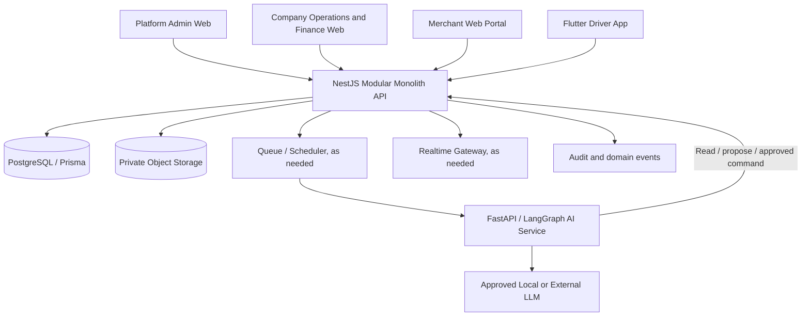

PROPOSED — not a decision

# Fleetora — Architecture, Database & Implementation Blueprint

**Status:** Proposed technical blueprint based on adopted business rules through BR-137 **plus the four approved post-BR requirements amendments (AM-01–AM-04)**. Not a claim about what is currently implemented in the repository.

## 1. Baseline and review findings

Source baseline: `Fleetora_Master_Project_Document.md` (conceptual architecture and provisional state machine). Business decisions BR-001–BR-137 in the requirements discussion govern where they differ from older provisional descriptions. BR-025 and BR-067 were skipped, not approved. BR-128 supersedes the previously deferred location question.

### Reconciliation decisions

1. Old `CREATED -> PLANNED -> ASSIGNED -> DISPATCHED -> PICKED_UP -> OUT_FOR_DELIVERY -> DELIVERED` is a *sample happy path*, not a universal mandatory sequence. Direct merchant-to-customer delivery is allowed; warehouse transfers are optional.
2. Operational status, assigned task, physical custodian/location, and financial settlement are distinct state machines. Never use `assignedDriverId` as the authoritative custodian.
3. Customer has no Fleetora account; merchant has one login, no branch accounts; merchant belongs to one active delivery company at once, with read-only historic access to the previous relationship after exit.
4. Financial model is considerably broader than original baseline: COD, merchant statements, fees, refunds/adjustments, partner settlements, expense accounting, driver compensation/advances, all with append-only transaction history.
5. BR-112 per-operation driver commission and BR-113 percentage split are compatible: define an eligible commission *pool* per event or parcel as configured, then allocate its sum across documented participants; do not pay twice for the same entitlement.
6. BR-088 allows COD and fully prepaid; end-customer partial payment at delivery is forbidden by BR-098. This does not prohibit partial *internal settlements* between driver/company or company/merchant.
7. BR-103 excludes an internal shipment chat; BR-105 excludes an operational merchant helpdesk. Keep scoped shipment notes and distinct financial dispute cases.
8. BR-067 is cancelled. Merchant settlement schedules (BR-090), GPS work mode (BR-128), and AI cron schedules (BR-135) are separate accepted concepts, not a resurrection of staff work-calendar rules.
9. BR-054 has no mandatory MFA. Authentication hardening and session controls remain essential.
10. BR-137 permits internal or reviewed external LLM providers, with tenant isolation, data minimization and approval-backed write operations; no direct database access for LLMs.
11. **AM-01 supersedes BR-065's single operational cashbox**: one named cashbox for each accountant and an admin consolidated view (sum of physical cashbox balances; inter-cashbox transfers are not company income). The one-currency-per-company decision BR-066 remains unchanged. This is not a full bank-account-management/ERP module.
12. **AM-02**: each driver has a shipment-custody box (a *logical list* of physically held parcels, separate from assigned tasks), and may receive an authorized bill/payment task to remit approved money to a merchant or other payee. Funding is either accountant-issued money or expressly authorized COD held by the driver; both paths require distinct documented transfers, actual payment evidence, liability-aware journal entries, and anti-double-spend controls.
13. **AM-03**: a driver who collects new parcels may deliver eligible nearby parcels directly without warehouse return. Operations/merchant policies gate eligibility; the system may suggest nearby drops, but driver remains in control of route order (BR-029). Confirm pickup custody before offering delivery; no implied delivery or transfer.
14. **AM-04**: shipment obstacle workflow separate from shipment status and custody: driver reports an obstacle; merchant can submit a resolution note (e.g., updated phone or retry instruction); the parcel appears in a resolved/ready-for-retry queue. A merchant resolution does not mark a failed attempt successful or mark the parcel delivered. Contact/address corrections retain prior values and obey BR-074/BR-101.

## 2. Target architecture

### Responsibilities
- **NestJS:** authentication, company isolation, RBAC, validation, domain transactions, custody, shipments, pricing, per-accountant cashboxes and reconciled transfers, driver payment tasks, obstacle resolution, finance ledger, driver compensation, subscription entitlements, approval gates, audit.
- **Next.js:** separate authorized experiences for Fleetora platform admin, delivery company staff, and single-account merchant. No independent financial/business-rule authority.
- **Flutter:** assigned tasks and separate physically-held shipment box, permitted pickup/direct-nearby-delivery workflows, payment tasks and cash funding receipts, obstacle reporting/resolution notes, camera scan, POD collection, separate COD receipt workflows, limited offline notes/attempts, GPS work sessions.
- **PostgreSQL:** all durable operational/financial state and integrity constraints. Use immutable event/ledger entries for audit-sensitive changes.
- **Object storage:** POD images/signatures and attachments using temporary authorized URLs, encrypted/private, retention policy.
- **Async workers:** scheduled statement prep, archive evaluation, notifications, AI job triggers, report exports; use retry/idempotency and outbox for reliability.
- **Python AI:** tenant-scoped tools through NestJS, recommendations and approval proposals, provider abstraction, budget controls, explainable summaries, no autonomous financial writes.

### Cross-cutting controls
Every tenant-scoped query and mutation must bind to authenticated company context; verify ownership through parent relationships rather than only client-supplied `companyId`. Scoped platform support grants are separately audited. Prefer centralized permission guards plus policy checks in domain services. Financial changes require database transactions, idempotency keys, actor and approval evidence. Store timestamps in UTC with display conversion in UI. Currency per company (BR-066), monetary values as integer minor units / exact decimal, never floating-point money. Validate cross-tenant joins and parent-child consistency.

## 3. Domain boundaries and database design

Below are *proposed entities*, not a final Prisma schema. Every company-owned row should have a tenant boundary (`companyId`) except global platform tables and explicitly cross-company partner agreements with carefully constrained references. Index leading `companyId` for tenant queries.

### A. Platform and identity
| Entity | Main fields / relationships | Key constraints |
|---|---|---|
| `Company` | id, name, baseCurrency, status, settings | Company currency single and controlled |
| `PlatformUser` / `CompanyUser` | identity, account status, credentials, company | Single company staff membership per employee (BR-043); separate platform role |
| `Role`, `Permission`, `RolePermission`, `UserRole` | scoped role catalog | Company and platform authorization isolated |
| `Delegation` | fromUser, toUser, permissionScope, expiresAt | Time-bound; no privilege escalation |
| `Merchant` | id, login identity, status | One merchant account, no merchant staff/branch hierarchy |
| `MerchantCompanyAgreement` | merchantId, companyId, activatedAt, terminatedAt, terms status | At most one concurrently active affiliated company per merchant; preserve history |
| `Plan`, `Subscription`, `FeatureEntitlement`, `UsageCounter` | features, periods, overrides, quota | Plan enforcement and overridable AI quota |

### B. Merchants, pricing and services
| Entity | Main fields / relationships | Key constraints |
|---|---|---|
| `MerchantAddress` | merchantId, label, city, description, default flag | Saved pickup/return addresses, no branch entity |
| `MerchantServicePermission` | agreementId, serviceType, enabled | COD, prepaid, urgent, partner handoff flags |
| `MerchantTariffVersion` | agreementId, version, effectiveAt, acceptedByMerchantAt, approvedByCompanyAt | No activate before both approvals; immutable prior tariff |
| `TariffRule` | tariffVersionId, locality/zone, service/return type, fee | Shipment gets effective price snapshot |

### C. Shipment and fulfillment
| Entity | Main fields / relationships | Key constraints |
|---|---|---|
| `Shipment` | id, companyId, merchantId, agreementId, trackingId, paymentMode, codDue, deliveryFeeSnapshot, currency, recipient, addressSnapshot, priority, status, version | Stable globally distinct tracking ID; COD or FULLY_PREPAID; client snapshots; optimistic version |
| `ShipmentEvent` | shipmentId, eventType, actor, occurredAt, reason, source | Append-only event history |
| `ShipmentAttempt` | shipmentId, taskId, attemptType, reasonCode, outcome, occurredAt | Failure != automatic return |
| `ShipmentObstacle` / `ObstacleResolution` | shipmentId, attemptId optional, reportedByDriverId, reason, status, merchantResolutionNote, proposedContactCorrection, timestamps | Distinct obstacle queue; resolution is not successful delivery; audit revisions |
| `ShipmentTask` | shipmentId, type PICKUP/DELIVER/RETURN/TRANSFER, assignee, status, scheduledAt | One active incompatible task per parcel; not custody |
| `TaskAssignmentEvent` | taskId, old/new driver, accepted/rejected, reason | Historical assignment/acceptance |
| `CustodyTransfer` | shipmentId, fromParty, toParty, initiatedAt, confirmedAt, status, evidence | Custody only transfers on verified receipt |
| `ShipmentLocation` / `CustodySnapshot` | shipmentId, currentHolderType/id, warehouseId | Derive or transactionally update from confirmed transfers |
| `DeliveryProof` | shipmentId, recipientActualName, method, fileRef, signedAt | Protect original POD, never publish on customer tracking link |
| `DeliveryFailureReason` | companyId nullable for standard codes, canonicalCategory, label | Standard + per-company reasons |
| `ReturnExchangeRequest` | originalShipmentId, newShipmentId, type RETURN/EXCHANGE, requiredLegs, status | New linked tracking ID, independent delivery/recovery legs |
| `Incident` | shipmentId, type DAMAGE/LOSS, evidence, determination, approvedRemedy | No automatic blame |
| `PickupBatch` / `PickupBatchItem` | merchant, address, assigned task, shipment items | Partial pickups, avoid two active pickups per parcel |
| `NearbyDeliverySuggestion` (optional derived projection) | driverId, custody-held eligible shipments, distance/route signal | Nonbinding suggestions; never require warehouse return or override driver routing |
| `Warehouse`, `Zone`, `Vehicle` | basic registry and company ownership | No full WMS or vehicle maintenance ERP |
| `PartnerAgreement`, `PartnerHandoff` | original/partner company, external partner marker, terms, handoff | Cross-company access only per explicit agreement; original merchant company remains contractual owner |

### D. Financial operations
**Recommended ledger design:** immutable `FinancialEntry` (companyId, accountCategory, debit, credit, currency, sourceType, sourceId, postedAt, reversalOfId) grouped by `FinancialTransaction` with balanced entries where accounting model warrants it. User-facing balances are derived or maintained as checked projections; never silently rewrite posted entries. **AM-01 overrides the single operational cashbox in BR-065**: model separately balanced per-accountant cashboxes and an admin read-only consolidated total. The consolidated figure is an aggregation, not another spendable cashbox. Physical cash and merchant COD liabilities must remain separately traceable. A cashbox transfer moves value between accounts with one linked transaction and cannot create revenue or duplicate cash.

| Entity | Purpose |
|---|---|
| `FinancialTransaction`, `FinancialEntry` | Append-only money movement, adjustments and audit trail |
| `Cashbox` / `CashboxAssignment` | One active cashbox per accountant; accountant access to own box, admin consolidated view; assignment history |
| `CashboxTransfer` | Two-sided authorized outgoing/incoming transfer with sender/receiver, confirmation, and linked journal transaction; no double-counting |
| `DriverCODCollection` | Confirmed customer cash receipt for fully paid COD shipment |
| `DriverCashHandover` | Declared vs counted vs confirmed amount, partial remittance, dispute status |
| `CashDispute` | Discrepancy case, reviewer and resolution, linked to handover |
| `MerchantSettlement` + `SettlementLine` | Periodic or on-request COD amounts, fees, credits, partial approved payments |
| `MerchantDispute` | Disputed vs undisputed settlement amounts; independent workflow |
| `PartnerSettlement` | Partner fees/remittances and partial payments |
| `DriverCommissionPolicyVersion` | Effective policies by event, zone, driver/company |
| `DriverCommissionAccrual` | One entitlement per qualifying event/pool, immutable policy snapshot |
| `DriverCommissionAllocation` | Percentage allocation to participants; percentages sum to 100% for approved pool |
| `DriverAdvance` | Approved and actually disbursed driver advance with outstanding balance |
| `DriverEarningsStatement`, `DriverPayment` | Salary + commissions - authorized offsets, approved partial actual payouts |
| `DriverPaymentTask` / `PaymentTaskFunding` / `PaymentTaskDisbursement` | Authorized invoice/payment order to merchant/other payee; funding via accountant cashbox handover OR allocated eligible driver-held COD; receiver acknowledgement/evidence and lifecycle |
| `CompanyExpense` | Basic expenses and payment approval, not full ERP |
| `PeriodClose` | Period approval and post-close adjusting entries in an open period |

### E. GPS, AI, files and audit
| Entity | Purpose |
|---|---|
| `DriverWorkSession` | Explicit start/end of location collection |
| `DriverLocationPoint` | driverId, workSessionId, lat/lon, accuracy, capturedAt, receivedAt, source idempotency key |
| `DriverTrip`, `DriverStop` | Derived routes/stops, distances subject to measurement uncertainty |
| `AIProvider` | Approved local/external model provider controls, not raw secrets in logs |
| `AgentDefinition`, `CompanyAgentEntitlement` | Available agents and per-company access |
| `AIExecution` | Run id, company, agent version, status, usage, scheduling key, reason |
| `AIRecommendation`, `AIProposedAction`, `AIApproval` | Reasons, scoped requested action, approvals, revalidation and result |
| `AISchedule`, `AIUsageCounter` | Manual/scheduled execution and monthly quotas |
| `Attachment` | Private object metadata, company scope, retention and authorization |
| `AuditLog`, `OutboxEvent` | Append-only important actions and reliable async publication |

### Essential invariants / indexes
1. `Shipment`: unique tracking ID; unique scoped external-order reference per merchant where provided; indexes `(companyId,status,createdAt)` and `(companyId,merchantId,createdAt)`.
2. Idempotency unique scope `(companyId, operationType, idempotencyKey)` for imports, payments, custody receipt, financial reversal, AI execution.
3. Use partial unique index for one active merchant affiliation and for mutually exclusive active task/pickup claims; migrations may need raw SQL beyond Prisma's declarative schema.
4. Handover confirmation must be atomic with custody update and event append; concurrency protected with row locking or conditional version update.
5. Financial journal entries never altered/deleted after posting; reversals/new entries correct mistakes, enforce balanced transaction entries and one reversal per source where applicable.
6. Commission allocation: validate 100% total at approval in a transaction and freeze snapshots; no double accrual from same entitlement key.
7. GIS points `(companyId,driverId,capturedAt)` with retention partitions when scale warrants; consider PostGIS only if actual geospatial queries need it.
8. Tenant access tests must include merchant historic view after company change, internal/external logistics partner flows, signed POD links and AI tool calls.
9. At most one *active assigned cashbox per accountant* (model transfer-of-ownership or an explicit reassignment process); only a confirmed balanced transfer updates sender and receiver. Reconcile the sum of cashbox physical balances to the ledger; do not add the consolidated display as an extra account.
10. `DriverPaymentTask` requires approved amount, payee, source authorization and an idempotent lifecycle; funding from COD reserves/allocates a precise, uncommitted amount and records a corresponding reduction/settlement of COD liability only upon authorized payment posting. Never silently treat COD as company revenue or spend already promised merchant funds.
11. Driver shipment box must be based on confirmed `CustodyTransfer`/custody projection, not on task assignment. Nearby proposals only for valid custody-held and delivery-eligible shipments; no duplicate assignment or route override.
12. A merchant obstacle resolution is versioned/audited, cannot assert a driver's attempted delivery succeeded, and cannot modify address pricing/contact evidence without the existing controlled correction policy.

## 4. Proposed workflow state design

**Shipment**: CREATED / READY_FOR_PICKUP / IN_TRANSIT / OUT_FOR_DELIVERY / DELIVERED / FAILED_ATTEMPT_PENDING / RETURN_IN_PROGRESS / RETURNED_TO_MERCHANT / CANCEL_RETURN_IN_PROGRESS / CANCELLED_CLOSED. This is illustrative; keep `FAILED_ATTEMPT` better as a `ShipmentAttempt` event rather than a terminal shipment state. A direct delivery may bypass warehouse.

**Obstacle**: OPEN (reported by driver) -> MERCHANT_ACTION_RECORDED / RESOLVED_FOR_RETRY -> RETRY_SCHEDULED -> CLOSED after outcome; can be REOPENED on repeated failure. This is a separate issue workflow/queue, not a delivery success status, not an internal helpdesk (BR-105), and does not change physical custody.

**ShipmentTask**: PENDING -> OFFERED (if driver acceptance is required) -> ACCEPTED -> IN_PROGRESS -> COMPLETED; alternative REJECTED/CANCELLED/REASSIGNED. Status and custody are separate.

**Custody**: merchant/driver/warehouse/partner receipt and handover chain; new custodian only after two-sided or otherwise authorized evidence-confirmed transfer, never by task assignment alone.

**Cashbox transfer**: REQUESTED -> APPROVED (per authority limits) -> HANDED_OVER -> RECEIVER_CONFIRMED/RECONCILED; alternative REJECTED/CANCELLED/DISPUTED. Journal entries for actual movement once confirmed, not merely requested.

**Driver payment task**: CREATED -> APPROVED -> FUNDING_RESERVED/RECEIVED -> IN_PROGRESS -> PAYEE_CONFIRMED -> RECONCILED; alternatives CANCELLED/FAILED/DISPUTED, with return/unreserve of unused funds. Driver compensation payouts (BR-115) are distinct from these delegated disbursement tasks.

**COD**: due snapshot -> fully collected on successful delivery -> driver cash obligation -> partially/fully handed over -> counted/confirmed or disputed -> reconciled; no partial end-customer COD shipment delivery.

**Exchange**: original delivered shipment stays DELIVERED; independent new request tracking for outward replacement and reverse collection, respecting merchant-specific old-item-first vs independent rule.

**AI**: REQUESTED/SCHEDULED -> RUNNING -> RECOMMENDATIONS_READY -> APPROVAL_PENDING -> APPROVED/REJECTED -> REVALIDATING -> PARTIALLY_EXECUTED/EXECUTED/FAILED. Approved writes go through NestJS domain services, with final revalidation.

## 5. Implementation plan (dependency-based)

| Phase | Deliverable | Exit/acceptance criteria |
|---|---|---|
| 0 — Repo audit & baseline | Inspect real repo schema/controllers/UI/tests, track gaps against approved BRs; create ADRs and RBAC matrix | Verified implemented vs missing, no speculative migration |
| 1 — Tenant & identity foundation | Company/merchant affiliation, company staff and roles, secure auth, plan entitlements | Company isolation and permission tests pass; merchant single-company affiliation enforced |
| 2 — Logistics core | Shipment creation, pricing snapshot, saved merchant addresses, pickup/task assignment, driver shipment box, events, physical custody, direct and nearby delivery, warehouse flows, obstacle-to-merchant-resolution queue | Complete parcel from merchant to customer; direct delivery without forced warehouse visit; obstacle resolution without false delivery; no custody transfer by assignment |
| 3 — Driver mobile | Flutter auth/tasks, task acceptance policy, QR/manual scan, POD, COD full collection, limited offline, driver availability | End-to-end real-device driver journey with retry/idempotency |
| 4 — Returns & partnerships | Failed attempts, cancel/return/exchange, warehouse/driver transfers, partner handoffs | Demonstrated failed delivery and closed merchant-acknowledged return |
| 5 — Finance core | Immutable journal, accountant cashboxes/consolidated admin view, confirmed inter-cashbox transfers, driver COD handover/matching/disputes, merchant settlements, authorized driver payment-task funding/disbursement, prepaid fees, adjustments, period close | Reconciliation correct under retries and concurrent updates; cashboxes sum properly; no double spending of cash/COD; independent approvals |
| 6 — Driver/partner finance & reporting | Driver commissions/splits/salary/advances/payments, partner settlements, finance reports and exports | Commission allocation sums to 100%, no duplicate accrual or payout |
| 7 — GPS & operational analytics | Adaptive GPS collection, routes/stops, privileged history access, KPI/dashboard, archive/export | Work-only tracking, permission-aware history, freshness indicator, retention tests |
| 8 — AI integration | Provider abstraction, tools, agent registry/entitlements, quota, schedules, proposal/approval/revalidation, logging | AI cannot cross tenants or mutate financial/delivery/custody records without real backend workflow |
| 9 — Production readiness | Security audit, restore rehearsal, observability, load test, concurrency/e2e, deployment/CI | Documented release gates and operational runbooks |

**Graduation-project demo slice:** phases 0–3 plus a thin verified COD/merchant settlement flow and one AI monitoring agent with approval/revalidation; progressively add the remaining commercial features. The entire BR inventory is product scope, not a requirement to build every function in the first demo.

## 6. Priority ADRs (technical decisions, not new business-rule questions)

- **ADR-01:** Use one NestJS modular monolith as business authority; AI separate FastAPI service, no direct AI SQL writes.
- **ADR-02:** Use scoped tenant context with explicit merchant historical access via affiliation history; all mutating controllers revalidate ownership.
- **ADR-03:** Append-only shipment events, custody events, financial journal; current state as transactionally maintained projections.
- **ADR-04:** Use PostgreSQL for transactional reliability; introduce Redis/queue where justified by background jobs and real-time scale, not by default for every process.
- **ADR-05:** Separate provider-independent AI agent framework and allow-listed tool calls; approval execution in core backend.
- **ADR-06:** GPS raw points are time-stamped, retention-limited, visible only within driver work sessions and authorized roles.
- **ADR-07:** Versioned policies (merchant tariffs, driver commissions, agreement terms) with effective dates and snapshots.
- **ADR-08:** Separate accountant cashboxes and their aggregate presentation from the financial ledger and COD liability buckets; post balanced, idempotent transfers.
- **ADR-09:** Authorize and reserve each delegated driver payment with explicit funding provenance and payee evidence; no implicit COD offsets.
- **ADR-10:** Treat obstacle resolution as a separate merchant-action workflow, and nearby direct delivery as an optional driver-controlled suggestion from eligible held parcels.

## 7. Remaining engineering verification (not more BR questions)

Before producing executable Prisma migration files or coding: audit current repository to determine actual Prisma version, tables, migrations and module maturity; identify actual cloud/object storage/map provider; benchmark location collection and lifecycle on Android/iOS; draft monetary ledger postings and approval matrix; confirm legal retention requirements and AI provider data-processing terms. No implementation status can be established solely from the master planning document.
